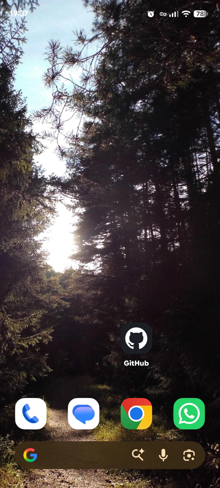
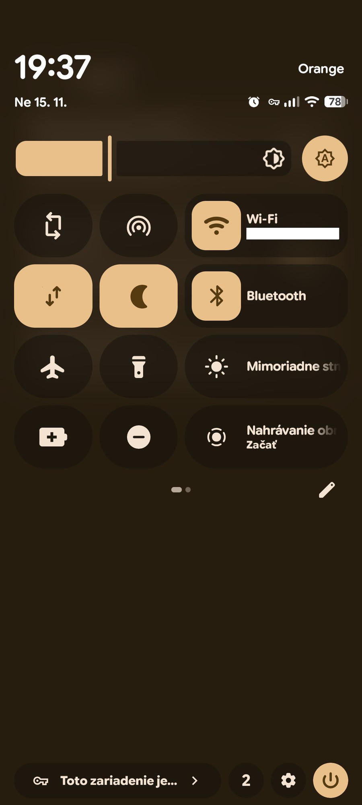

<p align="center">
  
</p>

<h1 align="center">Panther ROM</h1>

<p align="center">
  <a href="https://github.com/lineage-panther/panther-release-24.0/releases"></a>
  
  
  
  <a href="https://github.com/lineage-panther/panther-release-24.0/releases"></a>
</p>

An unofficial, community-maintained Android 17 / LineageOS 24.0-based build for Google Pixel 7 (`panther`).

This is an independent project. It is not affiliated with or endorsed by LineageOS or Google. Upstream components retain their own copyrights and licenses.

## Source repositories

The build is assembled using this project's [custom manifest](https://github.com/lineage-panther/android_manifests). The manifest references upstream sources, including:

- [LineageOS Android base manifest (`lineage-24.0`)](https://github.com/LineageOS/android/tree/lineage-24.0)
- [Pixel 7 device tree](https://github.com/LineageOS/android_device_google_panther/tree/lineage-24.0)
- [Shared Pixel device tree fork](https://github.com/lineage-panther/android_device_google_pantah/tree/lineage-24.0) (based on [LineageOS upstream](https://github.com/LineageOS/android_device_google_pantah/tree/lineage-24.0))
- [Tensor G2 common device tree](https://github.com/LineageOS/android_device_google_gs201/tree/lineage-24.0)
- [Pixel device kernels](https://github.com/LineageOS/android_device_google_pantah-kernels)
- [Proprietary Pixel 7 vendor files](https://github.com/TheMuppets/proprietary_vendor_google_panther/tree/lineage-24.0)

These source repositories are maintained by their respective upstream owners; this project is not affiliated with them.

## Showcase

These screenshots show the ROM running on a Pixel 7. The wallpaper, accent colors, installed apps, and some Quick Settings labels reflect the owner's personal setup and are not defaults guaranteed by the ROM.

| Home screen | Quick Settings |
| --- | --- |
|  |  |

## Status

The current release is **stable** following the maintainer's installation and functional testing on a Pixel 7 (`panther`). The maintainer reports the tested release is fully working. This is an unofficial build tested on the maintainer's device; it is not a guarantee for every device condition, firmware baseline, or installation path. Read the release notes and installation guide before installing.

## Build details

<!-- BEGIN AUTO-GENERATED BUILD DETAILS -->
- Android version: 17
- OTA build ID (`post-build`): `CP3A.261005.002.A1`
- OTA fingerprint: `google/panther/panther:17/CP3A.261005.002.A1/16269273:user/release-keys`
- Android security patch level: `2026-11-01`
<!-- END AUTO-GENERATED BUILD DETAILS -->

These values come from the release ZIP's OTA metadata. They identify this ROM build and are distinct from the stock firmware, bootloader, or baseband version currently installed on a device.

## Download

See the [Panther ROM 24.0 stable release](https://github.com/lineage-panther/panther-release-24.0/releases/tag/24.0-20261121) for the ROM ZIP, checksum, and matching boot images.

October 2026 LineageOS source changes for Pixel 7/Pantah included an Android 17 device-tree refresh, face-unlock overlays, leaner preinstalled-package configuration, and Tensor G2 camera-policy and AVB updates. See the [release notes](https://github.com/lineage-panther/panther-release-24.0/releases/tag/24.0-20261121) for linked upstream commits. The official [Panther Changes page](https://download.lineageos.org/devices/panther/changes) tracks upstream changes by device and build.

See the [installation guide](INSTALL.md) before installing.

Verify the ROM ZIP after downloading it:

```sh
sha256sum -c lineage-24.0-*-UNOFFICIAL-panther.zip.sha256sum
```

MindTheGapps is not included. Obtain any additional packages from their respective official sources.

## Release process

Builds may be published as untested candidates while they are being prepared. A stable release is published only after the maintainer installs and tests that build. The built-in Updater feed points to the current stable release. Older releases remain available on GitHub, but the Updater does not offer a one-tap downgrade.

## Report a bug or request a feature

Use the [issue tracker](https://github.com/lineage-panther/panther-release-24.0/issues/new/choose). Include the release tag, device, installation type, steps to reproduce, and expected and actual behavior. ADB logs are useful; redact serial numbers, account data, tokens, and other private information before attaching them.

## Contributing

Please read [CONTRIBUTING.md](CONTRIBUTING.md) before submitting a patch.
